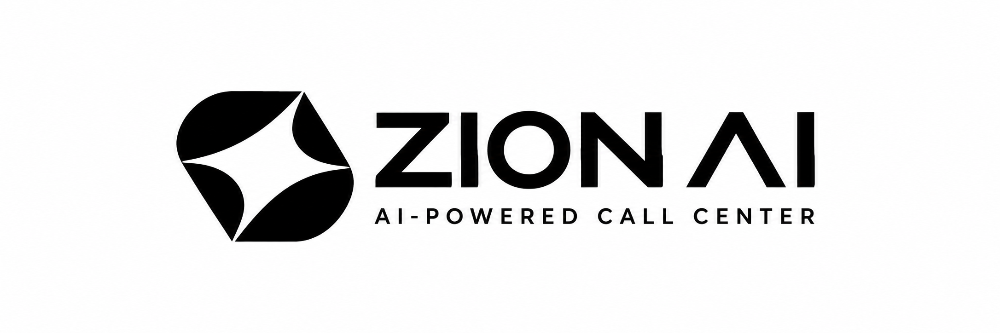

# Zion AI — Ethiopian Voice Agent Platform



> **Enterprise-grade Voice AI tailored specifically for Ethiopian Businesses.**  
> Fluent in **Amharic**, **Afaan Oromoo**, **Tigrigna**, **Kiswahili**, and **Somali**.

---

## 🌟 Key Features

- **Fluent in Ethiopian Languages**: Native voice AI supporting:
  - 🇪🇹 **Amharic** (`Selam.`)
  - 🇪🇹 **Afaan Oromoo** (`Akkam.`)
  - 🇪🇹 **Tigrigna** (`Selam.`)
  - 🌍 **Kiswahili** (`Hujambo.`)
  - 🇸🇴 **Somali** (`Iska warran.`)
- **Direct Lead Capture & Forwarding**:
  - Interactive "Book a Demo in Addis Ababa" modal.
  - Automatically captures work email, Ethiopian phone number (+251), business name, and language preferences.
  - Forwards booking details directly to **`ceo@zionsoftwareagency.com`**.
  - Local database log saved to `leads.json` (`/api/leads` admin endpoint).
- **Trusted Ethiopian Banking Partners**:
  - Integrated partner carousel featuring official logos of Commercial Bank of Ethiopia (CBE), Awash Bank, Bank of Abyssinia, Dashen Bank, Telebirr, CBE Birr, and more.
- **Transparent ETB Pricing**:
  - Localized in Ethiopian Birr (`ETB 3,500/mo` Starter, `ETB 8,500/mo` Growth, `ETB 18,500/mo` Enterprise).
  - No foreign currency / Mastercard required — payable via Telebirr, CBE Birr, Awash Bank, or Chapa.
- **Interactive Audio & Speech Synthesis**:
  - In-browser simulated voice player with Web Audio API chime generation and real-time interactive language switching.

---

## 🚀 Getting Started

### Prerequisites
- Node.js (v18+ or v20+ recommended)

### Run Locally

1. **Clone the repository:**
   ```bash
   git clone https://github.com/soresagetachew/zion-ai-website.git
   cd zion-ai-website
   ```

2. **Start the local server:**
   ```bash
   npm start
   # or
   node dev-server.js
   ```

3. **Open in browser:**
   ```
   http://localhost:3000/
   ```

---

## 📬 Contact & Booking

- **Direct Line**: `+251994575145`
- **Email**: `ceo@zionsoftwareagency.com`
- **Headquarters**: Addis Ababa, Ethiopia

---

## 📄 License
ISC © Zion AI / Zion Software Agency
